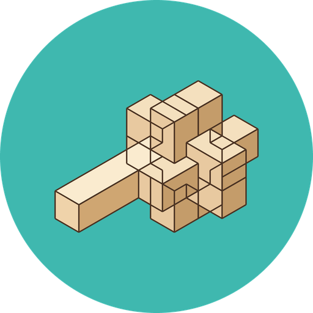
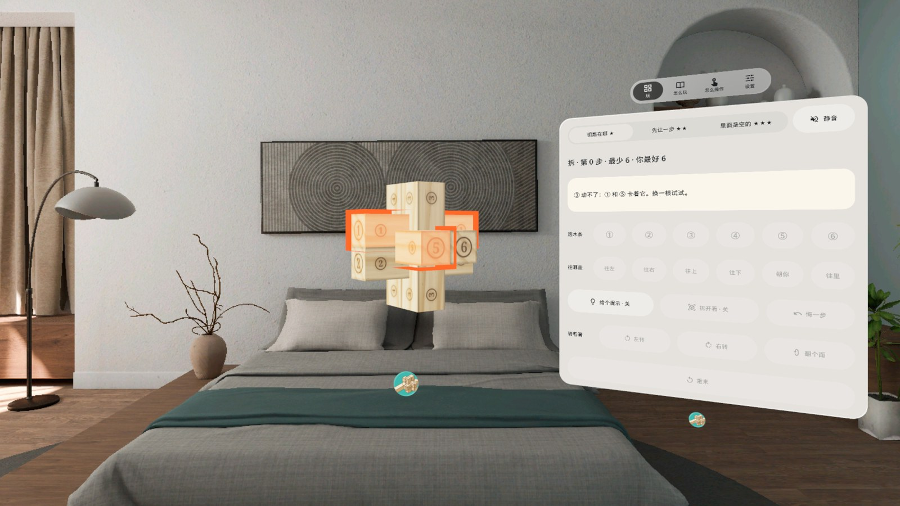
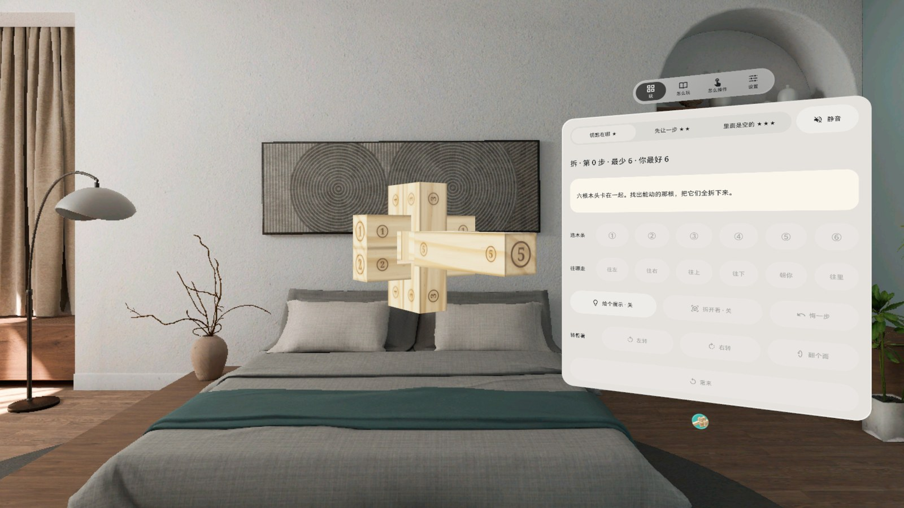
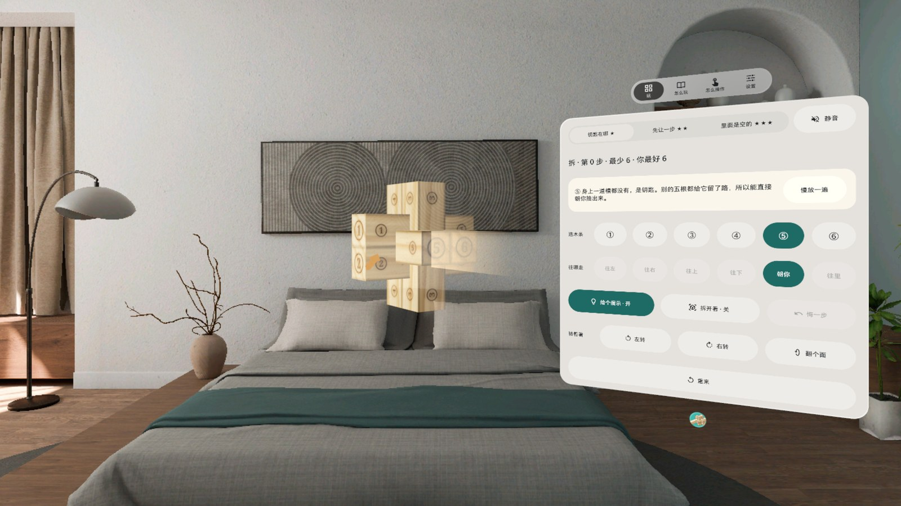
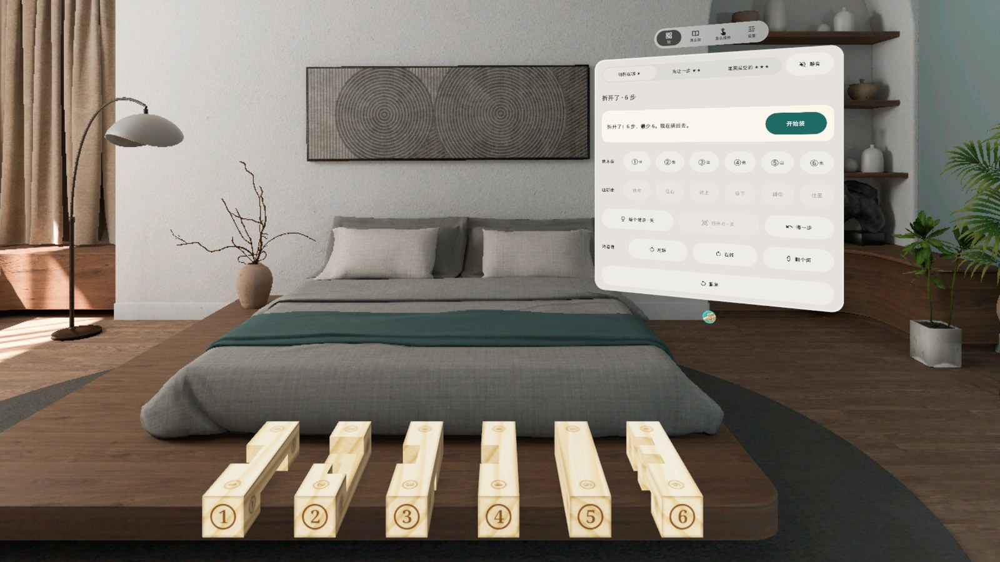
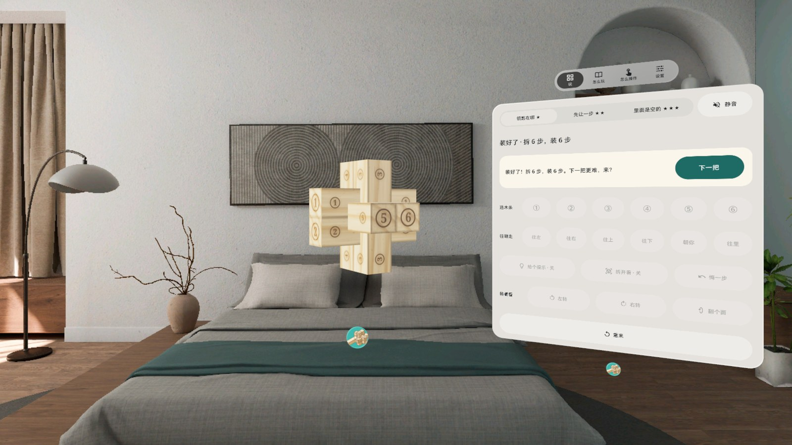

<p align="center"></p>

# Luban Lock | 鲁班锁

> **v0.1.4 · 正式版**：锁放大到 4 倍、窗口能拆时自动长大；改窗口大小不再重建场景；控制窗按钮 64 dp、新增「怎么操作」页；冷启动浅色底。模拟器 QA 第 4 轮通过，已在 PICO 头显上试玩通过。
> **v0.1.4 release**: the lock is 4x and its volume grows while sticks can come out; resizing no longer rebuilds the scene; 64 dp control-window buttons and a new Controls page; light background on cold start. Passed emulator QA round 4 and played on a PICO headset.

## 安装 / Install

APK 在 [Release v0.1.4](https://github.com/kejing-dev/LubanLock/releases/tag/v0.1.4)：

```bash
adb install -r LubanLock-v0.1.4.apk
pico-cli app launch io.embodit.lubanlock
```

`LubanLock-v0.1.4.apk` 是 `assembleRelease` 出的**未签名**包（上架用，平台托管签名）；直接装头显要先签名，或在本机 `./gradlew assembleDebug` 后装 `app/build/outputs/apk/debug/app-debug.apk`。头显上如果装过别的电脑签名的旧版、报 `INSTALL_FAILED_UPDATE_INCOMPATIBLE`，先 `adb uninstall io.embodit.lubanlock` 再装。
The release APK is an **unsigned** `assembleRelease` build (for store submission, signed by the platform); to sideload, sign it first or build `./gradlew assembleDebug` and install the debug APK. If an older build signed on another machine is installed and you get `INSTALL_FAILED_UPDATE_INCOMPATIBLE`, run `adb uninstall io.embodit.lubanlock` first.

PICO OS 6 · PICO Spatial SDK 6.1 · Kotlin / SpatialUI · `io.embodit.lubanlock` · v0.1.4 · 离线、中英双语、无需账号


> 截图和演示视频（Release 附件 `video-01.mp4`）来自原生 PICO 模拟器，由调试命令驱动；**非真实手势录像**。
> Screenshots and the demo video (`video-01.mp4` in the release) come from the native PICO emulator, driven by debug commands; **not a recording of real hand gestures.**

---

## 中文

### 这是什么

桌上浮着一只六根木头卡在一起的鲁班锁（孔明锁，放大 4 倍）。在旁边的控制窗按编号 ①–⑥ 选一根，它能往哪走，方向键就亮；点方向键，它就顺着槽滑出来、落到桌上。六根全拆下来，再一根根装回去。每一步都告诉你这根为什么现在能动、被卡住时是哪一根卡着它。三把锁由易到难：钥匙在哪 / 先让一步 / 里面是空的。

### 怎么玩

- **选木条**：控制窗「选木条」一行的 ①–⑥ 编号把手。选中的木条亮暖光、描金边。
- **滑动**：「往哪走」一行的 6 个方向键（左 / 右 / 上 / 下 / 朝你 / 往里），只有能走的方向亮。
- **被卡住**：卡着它的那根木条亮红光，说明框写出是谁挡着。
- **给个提示 / 拆开看 / 悔一步 / 左转 / 右转 / 翻个面 / 重来**：都在控制窗里。
- 3D 里只有整把锁一个可点目标：控制窗关了时点锁就能重新打开。

### 容器

Shared Space 体积窗口（`IN_VOLUME`）放锁和桌上一排木条：锁装好时 0.62 × 0.47 × 0.565 m，锁几乎撑满；能拆出来时长到 1.36 × 1.56 × 1.60 m（v0.1.3）。旁边一块 720 × 760 dp 的 SpatialUI 控制窗（玩 / 怎么玩 / 怎么操作 / 设置）。系统负责摆放、拖动和缩放，不需要平面识别和锚点。锁默认绕竖直轴转 35°，六根都看得到。

### 截图（模拟器，中文界面，v0.1.4）

| | |
|---|---|
|  |  |
| 顶住 — 说明框写出谁卡着它 | 抽出来了 — 木条顺着槽滑出锁外 |
|  |  |
| 给个提示 — 告诉你钥匙是哪根、为什么 | 拆开了 — 六根按编号摆在桌上，开始装 |
|  |  |
| 装好了 — 拆 6 步、装 6 步 | 英文界面 |

截图 2026-11-18 在 v0.1.4 上重拍（PICO 模拟器 High Definition 2560，原生裁 16:9，不放大），状态用调试广播定住。

### 验收状态

- 模拟器 QA：第 4 轮通过（只用 ①–⑥ 把手和方向键真实点按，拆 6 根、装 6 根到装好；改窗口大小 4 轮 0 次重建；中英冷启动浅色底、对比度 ≥ 6.27:1；全程无崩溃 / ANR / 文字溢出）。
- **真机**：v0.1.4 已装 PICO 头显并试玩通过（2026-11-17）。

### 已知问题

- 窗口变大时（选中一根能抽出的木条、或装好后），系统改尺寸过渡会让锁先放大约 1.5 倍约 0.25 s 再回原样（平台行为，应用侧去不掉）。
- 默认视角看不到锁的顶面（不挡玩，需要时用「翻个面」）。
- 选中 6 s 不操作会自动取消选中。

---

## English

### What it is

A six-piece Luban lock (Kongming lock, six-piece burr, shown at 4x) floats over your desk. Pick a stick with the numbered ①–⑥ handles in the control window; the direction keys it can move along light up. Tap one and the stick slides along its slot and drops onto the desk. Take all six apart, then put them back one by one. Every step explains why this stick can move now, and when it is blocked, which stick is in the way. Three locks, easy to hard: Where's the key / Make room first / Hollow inside.

### How to play

- **Pick a stick**: the ①–⑥ handles in the control window. The selected stick glows warm with a gold outline.
- **Slide**: six direction keys (left / right / up / down / toward you / away); only the possible ones light up.
- **Blocked**: the stick in the way glows red and the caption names it.
- **Hint / Open up / Undo / Turn left / Turn right / Flip / Start over** are all in the control window.
- The whole lock is the only tap target in 3D: tap it to reopen the control window after closing it.

### Container

A Shared Space volume (`IN_VOLUME`) holds the lock and the row of sticks on the desk: 0.62 × 0.47 × 0.565 m while the lock stands assembled, so it nearly fills it, growing to 1.36 × 1.56 × 1.60 m while sticks can come out (v0.1.3). Next to it is a 720 × 760 dp SpatialUI control window (Play / How to play / Controls / Settings). The system places, moves and scales it; no plane detection or anchors needed. The lock is turned 35° about the vertical axis so all six sticks are visible.

### Status

- Emulator QA round 4 passed: full take-apart and reassembly with real taps on the handles and direction keys only; 4 resize rounds with no rebuild; light background on cold start in both languages (contrast ≥ 6.27:1); no crash / ANR / text overflow.
- **Headset**: v0.1.4 installed and played on a PICO headset (2026-11-17).

### Known issues

- When the volume grows (a stick that can come out is selected, or the lock is solved), the system's resize transition shows the lock about 1.5x larger for about 0.25 s before it settles (platform behaviour).
- The default view does not show the top face of the lock (use Flip if needed).
- A selection is cleared after 6 s without input.

## Licences

Code: all rights reserved by the author. Fonts: Noto Sans (SIL OFL 1.1, `third_party/noto-sans`). Icons: Material Icons (Apache-2.0). Sounds: CC0 recordings (freesound cmorris035 #254343, Kenney impact-sounds / interface-sounds).
